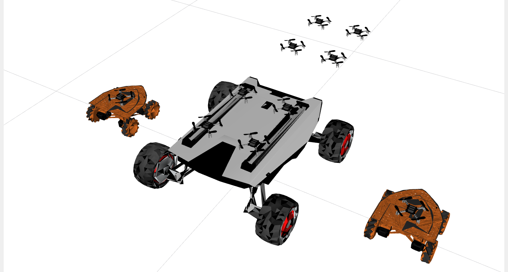

# hero_sim

[](https://github.com/KhAlamdar11/hero_sim/actions/workflows/ci.yml)

A lightweight simulator for the HERO robots: Crazyflie drones and ground robots (herover, scout), shown in RViz. There is no physics engine, so robots move exactly as commanded. That makes it quick to start and easy to test your code. You command the robots through the same ROS 2 topics and services as the real ones.

<p align="center">
  
</p>

## Setup

You need the `icuas26_finals` docker container. Run every command in this README inside it.

1. Get the code into your workspace:
   ```bash
   cd ~/ros2_ws/src
   git clone https://github.com/KhAlamdar11/hero_sim.git
   ```
2. Build it, together with the Crazyflie messages it needs:
   ```bash
   cd ~/ros2_ws
   colcon build --symlink-install --packages-up-to hero_sim
   ```
3. Open a new terminal, which loads the workspace automatically, or run `source ~/ros2_ws/install/setup.bash` in this one.

After you pull new changes, run step 2 again.

## Start and stop

```bash
cd ~/ros2_ws/src/hero_sim/startup
bash start.sh tether_demo.yaml      # start a scenario
tmux kill-session -t hero_sim       # stop
```

`start.sh` opens a tmux session with the simulator and RViz. Without a scenario name, it starts the default one, set by `DEFAULT_CONFIG_NAME` at the top of `startup/_setup.sh`.

To run it without tmux, use `ros2 launch hero_sim sim.launch.py config:=tether_demo.yaml`. The map isn't drawn in RViz then, but robots still bump into it.

## Scenarios

A scenario is one YAML file in `config/`. It says which robots there are, where they start, and what's in the world.

| Where | What |
|---|---|
| `config/tether/` | the tether task |
| `config/mrs/` | multi-robot scenarios with Crazyflies |
| `config/` | the example and everything else |

Start a scenario by its filename. It's found in whichever folder it's in: `bash start.sh test_many.yaml`. You can also name the folder (`mrs/test_many.yaml`) or give the path to a file anywhere.

To make your own, copy `config/example.yaml` (it explains every option) to, say, `config/my_test.yaml`. Edit it and run `bash start.sh my_test.yaml`. Filenames must be unique across the folders.

A small scenario:

```yaml
ground_robots:
  - name: herover_1
    pose: {x: 0.0, y: 0.0, yaw: 0.0}    # m, m, rad
    drive: omni                         # omni (can move sideways) or diff (can't)
    model: herover                      # herover or scout

crazyflies:                             # named cf_1, cf_2, ... in this order
  - pose: {x: 1.0, y: 0.0, z: 0.03}

obstacles:                              # optional pillars
  - {x: 2.0, y: 1.0, radius: 0.3}

sim:
  map: null                             # no map: an empty floor
```

## Moving the robots

Every robot's pose is on `/<name>/pose` (`geometry_msgs/PoseStamped`, in the `world` frame) and on TF.

### Ground robots

| Name | Type | |
|---|---|---|
| `/<name>/cmd_vel` | topic, `geometry_msgs/Twist` | velocity in the robot's own frame. Kept until the next message, so one is enough |
| `/<name>/go_to` | service, `crazyflie_interfaces/srv/GoTo` | drive to x, y and yaw in about `duration` seconds |

```bash
ros2 topic pub --once /herover_1/cmd_vel geometry_msgs/msg/Twist "{linear: {x: 0.5}}"
ros2 topic pub --once /herover_1/cmd_vel geometry_msgs/msg/Twist "{}"    # stop
ros2 service call /herover_1/go_to crazyflie_interfaces/srv/GoTo \
    "{goal: {x: 1.0, y: -1.0}, yaw: 1.57, duration: {sec: 3}}"
```

- Speed is limited to 2 m/s and turning to 2 rad/s. A `go_to` that asks to go faster just takes longer.
- Any `cmd_vel` message cancels a `go_to`.
- `go_to` exists only in the simulator. On the real ground robots, use `cmd_vel`.
- A ground robot's pose height is the top of its deck, where the motion-capture markers sit on the real robot, not 0.

### Crazyflies

The same services as the real Crazyflies (crazyswarm2):

| Name | Type | |
|---|---|---|
| `/cf_1/takeoff` | `crazyflie_interfaces/srv/Takeoff` | rise to `height` |
| `/cf_1/go_to` | `crazyflie_interfaces/srv/GoTo` | fly to x, y, z and yaw in `duration` |
| `/cf_1/land` | `crazyflie_interfaces/srv/Land` | come down to `height` |
| `/all/takeoff`, `/all/go_to`, `/all/land` | | the same, for every Crazyflie at once |

```bash
ros2 service call /cf_1/takeoff crazyflie_interfaces/srv/Takeoff "{height: 1.0, duration: {sec: 2}}"
ros2 service call /cf_1/go_to crazyflie_interfaces/srv/GoTo "{goal: {x: 1.0, y: 1.0, z: 1.0}, duration: {sec: 3}}"
ros2 service call /cf_1/land crazyflie_interfaces/srv/Land "{height: 0.0, duration: {sec: 2}}"
```

The low-level setpoint topics (`cmd_position`, `cmd_hover`, ...) work too.

## Obstacles

A robot stops when it would hit something, and moves again once you command it away. These block it:

- the map's trunks and posts, in scenarios with a `map:`;
- pillars, from the scenario's `obstacles:` list;
- other ground robots.

Drones are blocked at any height: they have to fly around a trunk or a pillar, not over it. Drones don't collide with ground robots or with each other.

Each robot is a circle, and its size is its `radius:`, which you can set per robot (defaults: herover 0.17 m, scout 0.42 m, Crazyflie 0.1 m). To turn all collisions off, set `sim: {collision: false}`.

Your code can read the pillars from `/hero_sim/obstacles` (`visualization_msgs/MarkerArray`). There's one cylinder per pillar: `pose.position` is its center, and `scale.x` its diameter.

```bash
ros2 topic echo --once /hero_sim/obstacles
```

## Tether task

Get an object into a goal circle on the floor. A tether runs from a fixed winch, through a pulley on a ground robot (UGV), through a ring on a Crazyflie (UAV), and down to the object.

```bash
bash start.sh tether_demo.yaml
```

How the tether behaves:

- The winch pays out a tether length L. The part hanging below the UAV is l = L − |winch − UGV| − |UGV − UAV|.
- While the tether is slack, the object stays where it is.
- Once it's taut, the object slides along the floor toward the point under the UAV.
- The object is never lifted. Reeling in further only makes the winch slip.
- Pulled into an obstacle, the object gets stuck until you pull it away from it.
- The robots don't feel the tether, and the tether line passes through obstacles. Only the object gets stuck.

Drive the UGV and fly the UAV as in [Moving the robots](#moving-the-robots). The winch and the object:

| Topic | Type | |
|---|---|---|
| `/winch/cmd_rate` | `std_msgs/Float64` | your input, m/s: positive pays out, negative reels in. Kept until the next message |
| `/winch/length` | `std_msgs/Float64` | L |
| `/tether/free_length` | `std_msgs/Float64` | l |
| `/tether/taut` | `std_msgs/Bool` | the tether is taut |
| `/tether/stuck` | `std_msgs/Bool` | the object is stuck against an obstacle |
| `/tether/object_pose` | `geometry_msgs/PoseStamped` | the object's center |
| `/tether/goal` | `geometry_msgs/PoseStamped` | the goal's center |
| `/tether/goal_reached` | `std_msgs/Bool` | the object's center is inside the goal circle |

```bash
ros2 topic pub --once /winch/cmd_rate std_msgs/msg/Float64 "{data: -0.3}"   # reel in
ros2 topic pub --once /winch/cmd_rate std_msgs/msg/Float64 "{data: 0.0}"    # hold
```

The `tether:` section of `config/tether/tether_demo.yaml` sets where the winch, the object and the goal are, and which robots carry the tether. `config/example.yaml` explains each key.

## Troubleshooting

| Problem | What to do |
|---|---|
| `config not found` | Check the filename: `ls ~/ros2_ws/src/hero_sim/config/*` |
| `... is in more than one folder` | Two configs share a filename: name the folder (`mrs/my.yaml`) or rename one. After configs were moved, an old build can also cause it: `rm -rf ~/ros2_ws/build/hero_sim ~/ros2_ws/install/hero_sim`, then build again |
| `Package 'hero_sim' not found` | Build ([Setup](#setup) step 2), then open a new terminal |
| `ros2 launch` doesn't find a config you just added | Build again. `start.sh` finds new files without a rebuild |
| A robot doesn't move | It may be pressed against an obstacle: command it away. Check that the simulator is running: `ros2 node list` |
| A `go_to` stops right away | Something keeps publishing `cmd_vel` to that robot, such as a `ros2 topic pub` without `--once` |

## For hero_mrs_control_stack users

- With `hero_mrs_msgs` in the workspace, `/sim/attach_agent` starts: robots carry docked Crazyflies, and an empty `parent_id` locks a Crazyflie in place (perched on a branch).
- `gripper: true` on a Crazyflie draws a two-claw gripper. To fit a new one: `ros2 service call /sim/cf_1/add_gripper std_srvs/srv/Trigger`.
- `sim: {models: false}` hides the robot models in RViz. The mesh tools are described in [models/README.md](models/README.md).
